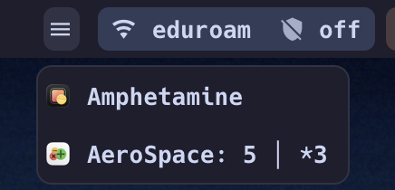

# sketchybar-menu-items



tiny helper for sketchybar that lists and clicks macOS menu bar items through the Accessibility api.

needs no screen recording permission! :)

## Install

```sh
git clone https://github.com/<owner>/sketchybar-menu-items
cd sketchybar-menu-items
make install
```

(puts menu-items in ~/.local/bin)

needs swift 6 toolchain and `jq`.

Whatever calls `menu-items` needs Accessibility permission. For SketchyBar, add `/opt/homebrew/bin/sketchybar` under System Settings > Privacy & Security > Accessibility and restart it.

## Usage

```sh
menu-items list [--ignore <glob>]...   # JSON, right to left
menu-items press <target>              # <pid>:<index>, <pid>/<identifier> or a glob
menu-items trust                       # check Accessibility permission
```

## SketchyBar

Copy `sketchybar/menu_items.sh` to your plugins folder and add:

```sh
sketchybar --add item menu_items right \
  --set menu_items icon=󰍜 label.drawing=off update_freq=15 \
    script="$PLUGIN_DIR/menu_items.sh" \
  --subscribe menu_items mouse.clicked mouse.exited.global front_app_switched system_woke
```

Ignore patterns go in `$CONFIG_DIR/menu_items.ignore`, one glob per line. See `sketchybar/menu_items.ignore`.

## License

MIT
